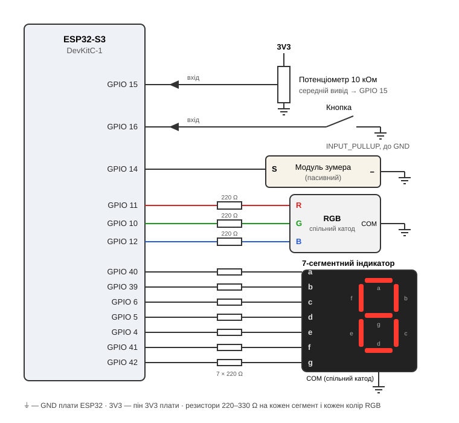

# Зламай замок (Hack the Lock)

Гра на ESP32-S3: плата загадує випадкову цифру від 0 до 9, а гравець має її вгадати.

- Потенціометром обираєш цифру — вона одразу з'являється на 7-сегментному індикаторі.
- Кнопкою підтверджуєш вибір.
- **Правильно** — зелений світлодіод, радісний сигнал, загадується нова цифра.
- **Неправильно** — червоний світлодіод і короткий низький сигнал.
- **3 помилки поспіль** — тривога. Поки вона звучить, кнопка не працює, після неї загадується нова цифра.

## Компоненти

- ESP32-S3 DevKitC-1
- 7-сегментний індикатор зі спільним катодом
- RGB-світлодіод зі спільним катодом
- Модуль пасивного зумера (S, −)
- Потенціометр 10 кОм
- Кнопка
- Резистори 220–330 Ω — 10 шт. (7 для сегментів, 3 для RGB)

## Схема



## Підключення

| Компонент | Вивід | ESP32-S3 |
|---|---|---|
| Потенціометр | середній вивід / крайні | GPIO 15 / 3V3 і GND |
| Кнопка | один вивід / інший | GPIO 16 / GND |
| Зумер | S / − | GPIO 14 / GND |
| RGB | R / G / B (через резистор) | GPIO 11 / 10 / 12 |
| RGB | спільний катод | GND |
| Індикатор | a / b / c / d / e / f / g (через резистор) | GPIO 40 / 39 / 6 / 5 / 4 / 41 / 42 |
| Індикатор | спільний катод (COM) | GND |

Якщо у вас індикатор або RGB-світлодіод зі **спільним анодом**, COM підключається до 3V3, а логіку в коді треба інвертувати (LOW — увімкнено).

## Збірка і завантаження

Проєкт на PlatformIO:

```
pio run -t upload
pio device monitor
```

Для налагодження загадана цифра виводиться в Serial Monitor (115200 бод).
